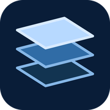
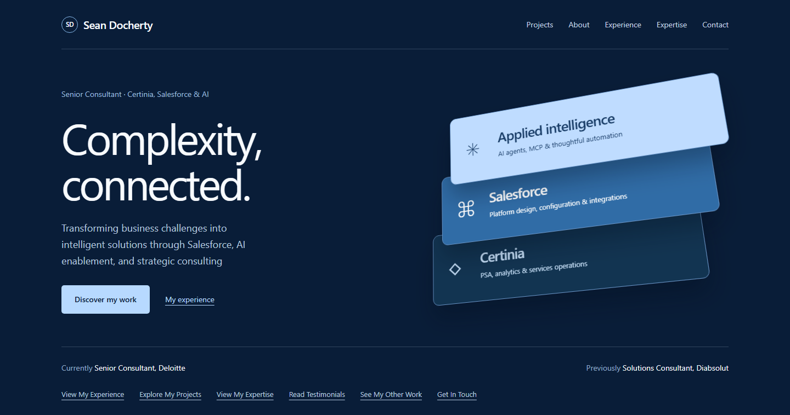

  

Click the icon above to access the page!

<h1 align="center">
Landing-Page
</h1>

<h2 align="center">This repository contains the source code for my personal portfolio landing page.</h2>

 

<a href="https://dochertydev.github.io/Landing-Page/">Explore the full portfolio</a>

